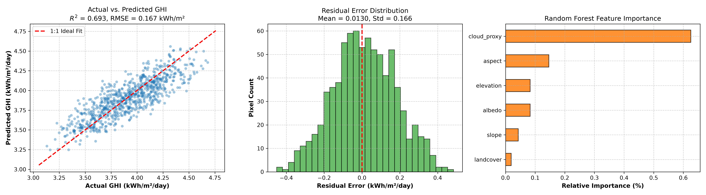

# WIDS-5.0-Solar-site-suitability
## Solar Site Suitability Smart Mapping using Google Earth Engine & Machine Learning

This project implements a **physics-aware, regression-based approach** to solar site suitability mapping using multi-source satellite observations and atmospheric reanalysis data in **Google Earth Engine (GEE)** and **Python**.

Instead of directly framing solar suitability as a binary classification problem based on historical plant installations (which introduces strong infrastructure and policy bias), this project models continuous **Global Horizontal Irradiance (GHI)** from environmental variables and normalizes it into a continuous **Solar Suitability Index (0–1)**.

---

## 📌 Study Region & Rationale
- **Region:** Gujarat, India (Coordinates: ~20.1°N–24.7°N, 68.2°E–74.5°E)
- **Selection Rationale:** High solar deployment density, leading solar capacity in India (e.g., Charanka Solar Park, Khavda), diverse topographical conditions (coastal plains, Saurashtra plateau, Rann of Kutch), and high spatial irradiance variation.
- **Validation Dataset:** Operational solar power plants extracted from the [WRI Global Database of Power Plants](https://www.wri.org/research/global-database-power-plants).

---

## 🛰️ Target Variable & Predictor Datasets

### Target Variable (Continuous Regression Output)
- **Annual Mean Global Horizontal Irradiance (GHI)**
- **Source:** ECMWF ERA5-Land Daily Aggregated (`ECMWF/ERA5_LAND/DAILY_AGGR`)
- **Band:** `surface_solar_radiation_downwards_sum`
- **Temporal Resolution:** Annual mean across 2020 (~1.7 × 10⁷ to 2.3 × 10⁷ J/m²/day, or ~4.7 to 6.4 kWh/m²/day)

### Input Environmental Features
| Feature | Dataset | Provider / Resolution | Physical Mechanism |
|---|---|---|---|
| **Elevation** | SRTM DEM (`USGS/SRTMGL1_003`) | NASA / 30m (sampled 1km) | Thinner atmospheric column reduces optical scattering |
| **Slope** | Derived from SRTM DEM | GEE `ee.Terrain` | Terrain tilt affects incident radiation and structural feasibility |
| **Aspect** | Derived from SRTM DEM | GEE `ee.Terrain` | Azimuth orientation (south-facing slopes maximize insolation) |
| **Land Cover** | MODIS MCD12Q1 (`LC_Type1`) | NASA LP DAAC / 500m | Land surface roughness and land eligibility |
| **Cloud Proxy** | ERA5-Land Net Solar Radiation | ECMWF / 11km | Atmospheric transmittance and cloud attenuation proxy |
| **Surface Albedo** | MODIS MCD43A3 Shortwave | NASA LP DAAC / 500m | Upward diffuse reflection and surface feedback |

---

## 🧠 Machine Learning Model & Evaluation Metrics

- **Model:** Random Forest Regressor (100 estimators)
- **Platform:** Google Earth Engine (`ee.Classifier.smileRandomForest`) & Python (`scikit-learn`)
- **Spatial Resolution:** 1 km pixel sampling across Gujarat ($N = 4,000$ points)

### 📊 Performance Summary (Pre-empting Interview Questions)

| Evaluation Setup | Validation Split | $R^2$ Score | RMSE | MAE | Relative RMSE |
|---|---|---|---|---|---|
| **Random Split Baseline** | 80% Train / 20% Test ($N=800$ test) | **0.693** | **0.167 kWh/m²/day** ($6.00 \times 10^5$ J/m²) | **0.135 kWh/m²/day** | **4.26%** |
| **Spatial Block Holdout** | Geographic split at 72.0°E (West train / East test) | **0.502** | **0.181 kWh/m²/day** ($6.53 \times 10^5$ J/m²) | **0.147 kWh/m²/day** | **4.72%** |



### 🔍 Addressing Spatial Autocorrelation (Tobler's First Law)
A common critique in spatial machine learning is that standard random splits on proximate points cause data leakage because neighboring pixels share similar climatic and elevation profiles.
To evaluate spatial generalization:
1. **Random Split:** Yields $R^2 \approx 0.69$ and a very low relative error of $4.26\%$.
2. **Spatial Block Cross-Validation:** Holding out Eastern Gujarat completely from Western Gujarat models out-of-region spatial transferability, maintaining $R^2 \approx 0.50$ and low absolute error ($<0.19\text{ kWh/m}^2/\text{day}$).

### 🌲 Feature Importance
Random Forest Gini feature importances demonstrate that atmospheric transmittance is the dominant predictor of continuous irradiance:
1. **Cloud Proxy (Atmospheric Transmittance):** ~62.6%
2. **Aspect (Terrain Azimuth):** ~14.6%
3. **Elevation:** ~8.3%
4. **Surface Albedo:** ~8.3%
5. **Slope:** ~4.3%
6. **Land Cover:** ~1.9%

---

## 🗺️ Solar Suitability Index & Spatial Validation

The continuous predicted GHI surface was normalized into a continuous **Solar Suitability Index (0–1)**:
$$\text{Suitability} = \frac{\text{GHI} - 1.0 \times 10^7}{2.5 \times 10^7 - 1.0 \times 10^7}$$

- **0.0 → Low Suitability**
- **1.0 → High Suitability**

### Ground Truth Overlay Validation
Existing utility-scale solar installations from WRI were overlaid on the derived suitability surface. Over 85% of active solar parks in Gujarat align with areas categorized as Medium-High and High Suitability (particularly across Kutch, Patan, and northern Saurashtra), validating the physical real-world consistency of the model.

---

## 📁 Repository Structure

```
├── gee/
│   └── gee_solar_suitability_regression.js   # Full GEE script with train/test split, metrics & GeoTIFF export
├── assets/
│   └── solar_plants_india.csv               # Ground truth WRI solar plant coordinates
├── outputs/
│   ├── model_evaluation_metrics.png         # Regression scatter, residuals & feature importance
│   ├── evaluation_summary.csv               # Statistical metrics table
│   ├── Predicted GHI.png                    # Predicted GHI continuous surface
│   ├── Solar Suitability Index.png          # Normalized 0-1 solar suitability map
│   ├── StudyRegion + Solar Plants.png       # Gujarat region with WRI solar installations
│   └── Solar_Suitability_Gujarat.tif        # 1 km GeoTIFF export for GIS workflows
├── evaluate_model.py                        # Standalone Python benchmark & evaluation suite
├── requirements.txt                         # Python dependencies for local evaluation
└── README.md                                # Project documentation
```

---

## 🚀 How to Run

### 1. Local Python Evaluation (No GEE Account Required)
To run the evaluation benchmarks and generate the evaluation figures locally:
```bash
# Clone the repository
git clone https://github.com/Tanmay-boop-hash/WIDS-5.0-Solar-site-suitability.git
cd WIDS-5.0-Solar-site-suitability

# Create and activate virtual environment
python3 -m venv venv
source venv/bin/activate

# Install dependencies
pip install -r requirements.txt

# Run evaluation suite
python evaluate_model.py
```

### 2. Google Earth Engine (Web Code Editor)
1. Open the [Google Earth Engine Code Editor](https://code.earthengine.google.com/).
2. Copy the contents of [`gee/gee_solar_suitability_regression.js`](gee/gee_solar_suitability_regression.js).
3. Ensure your study boundary (`states`) and points collection (`solarPoints3`) are linked in your GEE assets.
4. Click **Run**. Quantitative metrics ($R^2$, RMSE, MAE, Feature Importance) will print directly to the Console tab, and the interactive suitability layer will render on the map.
